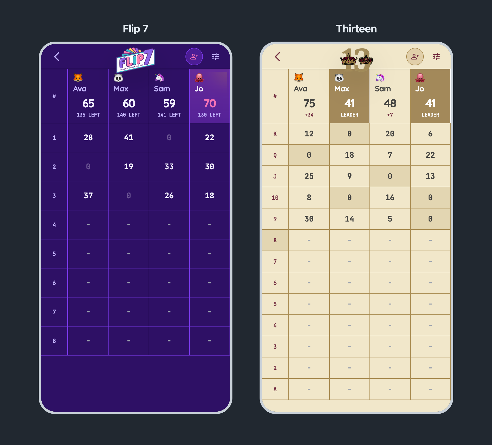
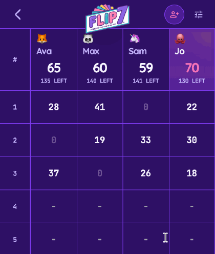
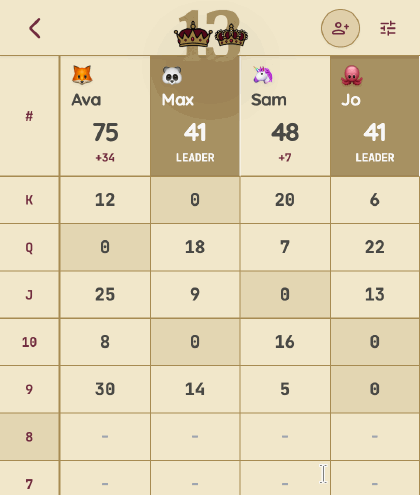
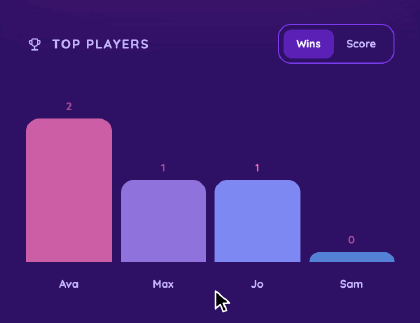
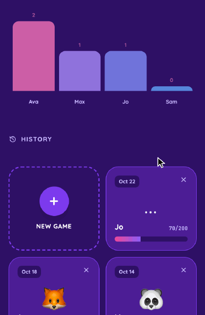

# `score`

A scorekeeper for game night, built for your phone. Flip 7 and Thirteen, with running totals, a leaderboard and every past game saved.

  
[<kbd> haaans.com/score  </kbd>](https://haaans.com/score/)

## Features

<table>
<tr valign="top">
<td width="50%">
<h3>Score a round of Flip 7</h3>

Tap a cell and type. Totals and points left to 200 update as you go, and when the round's done the leader moves to the front.

</td>
<td width="50%">

</td>
</tr>
<tr valign="top">
<td width="50%">

</td>
<td width="50%">
<h3>Play Thirteen, low score wins</h3>

Rounds count down from King to Ace, zeros are marked, and the lowest total wears the leader badge.

</td>
</tr>
<tr valign="top">
<td width="50%">
<h3>Flip the leaderboard</h3>

See who has the most wins, or who's scored the most points across every game.

</td>
<td width="50%">

</td>
</tr>
<tr valign="top">
<td width="50%">

</td>
<td width="50%">
<h3>New game, same crew</h3>

A new game starts with the same players and emojis, so the next round is one tap away. Everything is saved in your browser.

</td>
</tr>
</table>
